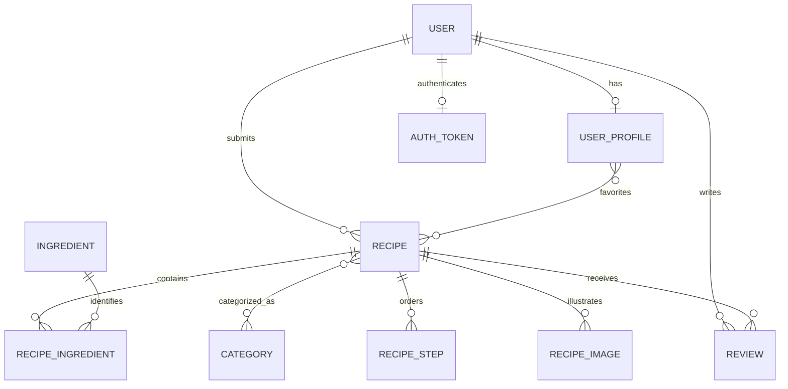

*This project has been created as part of the 42 curriculum by [team 42 logins to confirm].*

# Recipe Site

This README is a working draft. Team logins, role assignments, contributions and the final chosen-module list still need team confirmation. The module review below does not establish a completed 14-point total.

## Description

Recipe Site is a recipe-sharing application built for ft_transcendence. Visitors browse approved recipes and public profiles. Registered users submit recipes with ingredients, quantities, instructions and photos, edit their profiles, and post ratings and written reviews. Staff review submissions, explain rejections and decide recipe deletion requests.

The project uses the requirements in [ft_transcendence.pdf](ft_transcendence.pdf), version 21.1. Module requirements and the README requirements are separate from the application's feature checklist.

## Instructions

### Prerequisites

- Linux or WSL, running as your normal user.
- Python 3 and Git on the host.
- Docker Engine and the Docker Compose plugin, already installed, running and accessible to your account without `sudo`.
- A local Docker socket. The launcher does not support a remote Docker endpoint.
- Internet access for the initial container-image and dependency downloads.
- Chrome for the current local browser-trust workflow. WSL also needs Windows interoperability with `certutil.exe` and `wslpath` available.
- A private root `.env` with the project's credentials.

Node, Django and PostgreSQL run inside containers; installing them on the host is unnecessary for the normal launcher.

### Configure a checkout

From the repository root, create `.env` from the example only if you do not already have one:

```sh
cp -n .env.example .env
```

Edit `.env` and supply nonempty `DJANGO_SECRET_KEY` and `POSTGRES_PASSWORD`. For an existing installation, retain its credentials and stored data. Get the correct project configuration from your team when using a shared checkout.

| Setting | Purpose / default |
| --- | --- |
| `DJANGO_SECRET_KEY` | Private Django application secret; required. |
| `POSTGRES_PASSWORD` | Private database password; required. |
| `DJANGO_DEBUG` | Defaults to `False`. |
| `DJANGO_ALLOWED_HOSTS` | Example allows `localhost`, `127.0.0.1` and the internal `backend` hostname. |
| `DJANGO_POSTGRES_DB` | Backend database selection; defaults to `recipes`. |
| `HTTPS_PORT` | Optional external HTTPS port; defaults to `8443`. |
| `FRONTEND_PORT` | Optional HTTP redirect port; defaults to `5173`. |
| `SERVER_NAME` | Optional local certificate/server name; defaults to `localhost`. |
| `TLS_CERT_DIR` | Optional certificate directory; defaults to `./certs`. |

The private `.env`, certificate keys and local CA are machine configuration. `.env.example` documents the required settings without their values.

### Start the application

On Linux, close Chrome before the launcher updates its user certificate store. From the repository root, run:

```sh
sh scripts/start.sh
```

The launcher prepares certificate tools in Docker, creates or checks the local HTTPS certificate, imports the public CA into the supported user/browser trust store, prepares the shared database selection, and builds/starts the services. Django migrations and static-file collection run during backend startup. It then exports the current database and referenced photos to the shared folder.

On WSL, confirm the Windows user certificate-trust prompt if it appears. Fully restart Chrome after trust setup, including private windows.

Open **https://localhost:8443/** with the default configuration. HTTP on `http://localhost:5173/` redirects to HTTPS. Compose binds both published ports to the local loopback interface.

### Use the website

| Page | Purpose |
| --- | --- |
| `/` | Approved recipe rankings, recently added recipes and navigation. |
| `/results/search?q=rice` | Search approved recipe titles and public usernames/names. |
| `/recipe/<id>` | Recipe details, photos, ratings/reviews and authorized recipe actions. |
| `/add-recipe` | Signed-in recipe submission. |
| `/recipe/<id>/edit` | Owner/staff recipe editing. |
| `/profile` | Your own profile and submitted recipes. |
| `/users/<account-id>` | A public profile and its approved recipes. |
| `/staff` | Website recipe management for staff. |
| `/admin/` | Django administration for accounts with the necessary permissions. |

Use **Connect** to sign up or sign in. Login accepts a username or email address with a password. Pending/rejected recipe details are available to their owner and staff.

If you need to create the first local Django administrator, this command creates a superuser interactively:

```sh
docker compose exec backend python manage.py createsuperuser
```

Website staff status and Django model permissions are distinct: access to `/staff` does not by itself grant every Django-admin permission.

### Stop and inspect services

These commands inspect the service state/logs or stop containers while preserving their volumes:

```sh
docker compose ps
docker compose logs --tail=80 backend
docker compose stop
```

### Shared project data

The current transfer folder is `data/shared-database/`, containing `shared-data`, `manifest.json` and referenced photos. Normal startup loads a changed downloaded copy, retains local-only recipes and linked records, and exports the combined result. Git delivery remains manual.

To export changes made since startup:

```sh
sh scripts/export.sh
```

Export briefly stops the backend for a consistent snapshot, then restarts it. An API request during this pause may receive a temporary gateway error. Wait for export to finish before using the website.

The shared database archive is unencrypted. This transfer mechanism is not live synchronization: matching downloaded recipes take precedence, and conflicting edits, renames and deletions across computers have limitations. Normalized ingredient/category reuse protects website submissions; the importer preserves existing same-name records and their relationships.

## Team Information

Team confirmation is required for every member's 42 login and assigned roles. The subject requires Product Owner, Project Manager / Scrum Master, Technical Lead and developer responsibilities, with roles combined where appropriate.

| Role | 42 login(s) | Responsibilities to confirm |
| --- | --- | --- |
| Product Owner | Pending | Product direction, priorities and feature acceptance. |
| Project Manager / Scrum Master | Pending | Task coordination, planning and communication. |
| Technical Lead | Pending | Architecture, technical decisions and integration. |
| Developers | Pending | Each member's implemented features and modules. |

## Project Management

Git stores source changes. [WORK_LOG.md](WORK_LOG.md) records implementation decisions, source reviews, user-reported checks and remaining work. Functional acceptance in the current workflow is performed by the user; a source review is not a substitute for a browser/runtime check.

The team still needs to confirm its task board, communication channels, meeting/review process and work allocation for this section.

## Technical Stack

| Layer | Implementation and reason |
| --- | --- |
| Frontend | React 19, React Router 7 and Vite 8 provide component-based UI, browser routing and a production build. |
| Styling | Tailwind CSS 4 is configured alongside shared CSS tokens/components in `frontend/src/index.css` and `App.css`. |
| Backend | Django 6.1-range dependencies and Django REST Framework provide authentication, serializers, HTTP endpoints and administration. |
| Database | PostgreSQL 17 stores relational data. Django ORM models/migrations manage relationships and schema; transactions and locks coordinate writes. |
| Media | Pillow validates images. Uploaded files live in a Docker volume shared with Nginx for serving. |
| Deployment | Docker Compose runs PostgreSQL, Django/Gunicorn and the built frontend served by Nginx. |
| HTTPS | mkcert-based local certificates terminate at Nginx, which proxies API/admin traffic to the private backend. |

The frontend build uses Node 22; the backend image uses Python 3.13. See the Dockerfiles and package files for the actual dependency declarations. Django/DRF are one backend, rather than independently deployed microservices.

## Database Schema



| Model / storage | Key data and relationships |
| --- | --- |
| Django user | Username/email, hashed password, names and staff/permission metadata. |
| `UserProfile` | One user; text bio, optional image path and favorites relation. |
| DRF token | One token per user; sent through the website's `Authorization: Token …` header. |
| `Recipe` | Title (`varchar(100)`), text description, owner, timestamp, moderation/deletion booleans, rejection reason and integer `content_revision`. |
| `Ingredient` / `Category` | IDs and names (`varchar(100)`); names can be reused across recipes. |
| `RecipeIngredient` | Recipe/ingredient foreign keys, quantity and unit strings. Each recipe/ingredient pair is unique; website quantities must be positive numbers. |
| `RecipeStep` | Recipe, integer position and text instruction; positions are unique within a recipe. |
| `RecipeImage` | Recipe foreign key and image-file path. |
| `Review` | Recipe/user foreign keys, integer grade, text comment and timestamp; new website reviews require 1–5 stars and a nonblank comment. |

Uploaded bytes are stored in the media volume; image fields store their paths. The database also contains Django's session, group/permission, admin-log and migration tables. Source models are in `backend/users/`, `backend/recipes/` and `backend/reviews/`.

## Features List

Feature contributor names must be supplied by the team for this table before final submission.

| Implemented feature | Behavior | Main source |
| --- | --- | --- |
| Signup and login | Username/email checks, configured password rules, hashed passwords, token login/logout and clear duplicate-signup errors. | `backend/users/`, `SignupPage.jsx`, `LoginPage.jsx` |
| Own/public profiles | Own bio/photo updates; public identity/bio/photo and approved recipes; separate public/self response fields. | `backend/users/`, `ProfilePage.jsx`, `PublicUserProfilePage.jsx` |
| Recipe submission/editing | Ingredients with per-recipe quantities/units, steps, categories and validated photos; owner/staff write restrictions and transactional saves. | `backend/recipes/`, `AddRecipePage.jsx` |
| Recipe moderation | Staff approval/rejection, author-visible rejection reason, resubmission and deletion-request decisions. | `recipes/views.py`, `AdminPage.jsx`, `RecipePage.jsx` |
| Changed-content guard | Website edits increment a revision; stale staff approval/rejection is refused and asks for reload. | Recipe serializers/views, `moderationApi.js`, `RecipePage.jsx` |
| Ratings/reviews | Signed-in reviews of approved recipes, reviewer names/dates, 1–5 validation and refreshed averages/counts. | `backend/reviews/`, `recipeApi.js`, `RecipeReviewForm.jsx` |
| Discovery | Approved recipe-title/user-name search, public author links, recent recipes and 30-day rating/review rankings with real photo previews. | `HomePage.jsx`, `SearchResultsPage.jsx`, `RecipePreviewCard.jsx` |
| Duplicate prevention | Website names reuse existing IDs ignoring case/outer spaces; repeated ingredient/category rows are rejected, including direct API submissions. | Recipe serializers, `AddRecipePage.jsx` |
| Local deployment/data transfer | HTTPS startup, persistent volumes, health checks and shared database/photo import/export. | Compose, `frontend/nginx.conf`, `scripts/` |

The agreed recipe-admin feature scope has been accepted by the user. Qualification for a particular subject module still depends on that module's complete requirements and its evaluation demonstration.

## Modules

The team's final chosen-module list and contributors are pending confirmation. In this subject, a Major module is worth 2 points and a Minor is worth 1. Incomplete modules do not contribute points.

| Module | Points | Current source evidence / remaining qualification |
| --- | --- | --- |
| Frontend + backend frameworks — Major | 2 | React plus Django. Strong source evidence; demonstrate the running application. Do not also count the separate framework Minors. |
| ORM — Minor | 1 | Django models, relationships, migrations and querysets. Strong source evidence. |
| Advanced permissions — Major | 2 | Candidate: Django `UserAdmin` retains account CRUD/permissions and website owner/staff/guest actions differ. Demonstrate user CRUD, role/permission management and role-specific actions before claiming it. |
| Custom design system — Minor | 1 | Shared colors, typography and components exist. Confirm/document the required ten reusable components and icon system. |
| File upload/management — Minor | 1 | Image validation, profile previews and saved recipe photo removal exist. Complete the requirement check for supported file types, previews, upload progress, deletion and access policy. |
| Advanced search — Minor | 1 | Current title/name search needs the module's filters, sorting and pagination. |
| Public API — Major | 2 | Routes/token authentication exist. Rate limiting is missing; API documentation and how tokens meet the key requirement need completion/demonstration. |
| Standard user management — Major | 2 | Profiles/authentication exist; friends, online status and a default avatar remain absent. |
| User interaction — Major | 2 | Profiles/reviews exist; the module also requires chat and friends. |
| Health/status/backups — Minor | 1 | Container health checks and automatic startup exports exist; a status page and complete recovery demonstration remain. |
| Data export/import — Minor | 1 | Validated PostgreSQL bulk snapshot transfer exists; multiple record-export formats remain absent. JSON manifests are metadata rather than another record export. |
| Additional browsers — Minor | 1 | Requires completed feature checks in two additional browsers and documented limitations. No complete evidence is recorded. |
| Accessibility — Major | 2 | Labels/ARIA/native dialogs help, but source review does not establish full WCAG 2.1 AA compliance. |

The straightforward source-backed subtotal is **3 candidate points** from frameworks and ORM, before evaluation. Advanced permissions is a further **2-point candidate**, not an automatic completed claim. This table lists possibilities and gaps; it is not a selected 14-point plan. Custom modules require their own scope, implementation evidence, contributor attribution and justification.

## Individual Contributions

Pending team confirmation. For each 42 login, add the implemented features/modules, specific components or services, responsibilities and a concrete challenge with its resolution. Fill the contributor attribution in the feature/module sections as well.

## Current Limits and Verification

- Category browsing, favorites actions and related-recipe suggestions have unfinished UI paths; they are not counted as completed features here.
- Search currently has no advanced sorting/pagination. Friends/chat/presence, OAuth and 2FA are not implemented.
- Photo URLs are served publicly. Pending/rejected recipe page/API access is restricted separately; media serving remains the project's accepted scope.
- The shared-folder workflow preserves older duplicate-name records and has cross-computer conflict limitations.
- Recent changes were source-reviewed. Browser/runtime acceptance is user-led and recorded as reported in `WORK_LOG.md`; that does not certify every module or all supported browsers.

For a demonstration, use the normal launcher, then exercise signup/login, profile changes, recipe create/edit/photo handling, staff decisions, rejection/resubmission, deletion requests, ratings and search. Check visible state after reloading. The work log retains the detailed duplicate-name, signup-conflict and changed-content test procedures.

## Resources

- [Project subject](ft_transcendence.pdf): mandatory requirements, module criteria and required README sections.
- [React documentation](https://react.dev/learn): components, state and UI events.
- [Django documentation](https://docs.djangoproject.com/en/6.1/): ORM, authentication, admin and migrations.
- [Django REST Framework documentation](https://www.django-rest-framework.org/): serializers, requests, authentication and permissions.
- [PostgreSQL 17 documentation](https://www.postgresql.org/docs/17/): relational storage, transactions and database operations.
- [Docker Compose documentation](https://docs.docker.com/compose/): application services, volumes and lifecycle.
- [Vite documentation](https://vite.dev/guide/): frontend build tooling.
- [mkcert project](https://github.com/FiloSottile/mkcert): local certificate and browser-trust tooling.

### AI Use

AI assistance was used for source analysis, implementation proposals and code changes involving deployment/data-sharing scripts, React forms and search/profile UI, recipe moderation and stale-content checks, password validation, ratings, duplicate handling, source reviews and this README draft. The work log records the scope and verification of those sessions. Team members must review, test and understand the submitted implementation. Team confirmation is still needed for the complete project-wide AI-use attribution.
