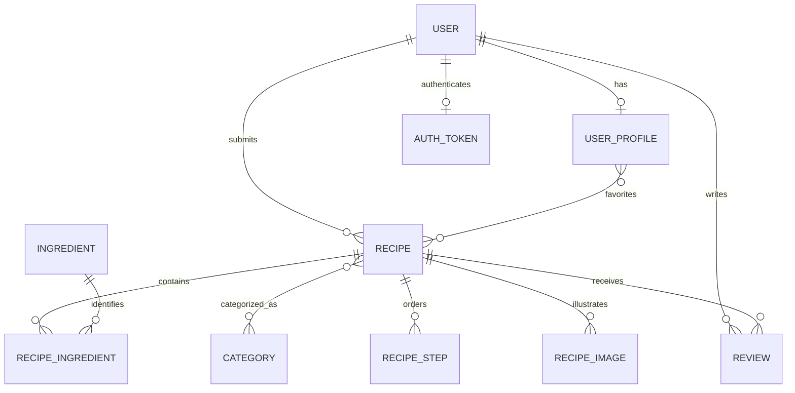

*This project has been created as part of the 42 curriculum by toferrei, nneves-a, suroh, hladeiro, famendes.*

# Recipe Site

The team names, 42 logins, roles, GitHub accounts and feature contributions below are confirmed. Commit-author aliases and the final chosen-module list with contributor assignments still need confirmation. The module review below does not establish a completed 14-point total.

## Description

Recipe Site is a recipe-sharing application built for ft_transcendence. Visitors browse approved recipes and public profiles. Registered users submit recipes with ingredients, quantities, instructions and photos, edit their profiles, save favorites, and post ratings and written reviews. Their own profile includes saved recipes and a review history. Staff review submissions, explain rejections and decide recipe deletion requests.

The project uses the requirements in [ft_transcendence.pdf](ft_transcendence.pdf), version 21.1. Module requirements and the README requirements are separate from the application's feature checklist.

## Instructions

### Prerequisites

- Linux or WSL, running as your normal user.
- Python 3 and Git on the host.
- Docker Engine and the Docker Compose plugin, already installed, running and accessible to your account without `sudo`.
- A local Docker socket. The launcher does not support a remote Docker endpoint.
- Internet access for the initial container-image and dependency downloads.
- Chrome for the current local browser-trust workflow. WSL also needs Windows interoperability with `certutil.exe` and `wslpath` available.
- A private root `.env` with the project's credentials.

Node, Django and PostgreSQL run inside containers; installing them on the host is unnecessary for the normal launcher.

### Configure a checkout

From the repository root, create `.env` from the example only if you do not already have one:

```sh
cp -n .env.example .env
```

Edit `.env` and supply nonempty `DJANGO_SECRET_KEY` and `POSTGRES_PASSWORD`. For an existing installation, retain its credentials and stored data. Get the correct project configuration from your team when using a shared checkout.

| Setting | Purpose / default |
| --- | --- |
| `DJANGO_SECRET_KEY` | Private Django application secret; required. |
| `POSTGRES_PASSWORD` | Private database password; required. |
| `DJANGO_DEBUG` | Defaults to `False`. |
| `DJANGO_ALLOWED_HOSTS` | Example allows `localhost`, `127.0.0.1` and the internal `backend` hostname. |
| `DJANGO_POSTGRES_DB` | Backend database selection; defaults to `recipes`. |
| `HTTPS_PORT` | Optional external HTTPS port; defaults to `8443`. |
| `FRONTEND_PORT` | Optional HTTP redirect port; defaults to `5173`. |
| `SERVER_NAME` | Optional local certificate/server name; defaults to `localhost`. |
| `TLS_CERT_DIR` | Optional certificate directory; defaults to `./certs`. |

The private `.env`, certificate keys and local CA are machine configuration. `.env.example` documents the required settings without their values.

### Start the application

On Linux, close Chrome before the launcher updates its user certificate store. From the repository root, run:

```sh
sh scripts/start.sh
```

The launcher prepares certificate tools in Docker, creates or checks the local HTTPS certificate, imports the public CA into the supported user/browser trust store, prepares the shared database selection, and builds/starts the services. Django migrations and static-file collection run during backend startup. It then exports the current database and referenced photos to the shared folder.

On WSL, confirm the Windows user certificate-trust prompt if it appears. Fully restart Chrome after trust setup, including private windows.

Open **https://localhost:8443/** with the default configuration. HTTP on `http://localhost:5173/` redirects to HTTPS. Compose binds both published ports to the local loopback interface.

### Use the website

| Page | Purpose |
| --- | --- |
| `/` | Approved recipe rankings, recently added recipes and navigation. |
| `/results/search?q=rice` | Search approved recipe titles and public usernames/names. |
| `/recipe/<id>` | Recipe details, photos, ratings/reviews and authorized recipe actions. |
| `/add-recipe` | Signed-in recipe submission. |
| `/recipe/<id>/edit` | Owner/staff recipe editing. |
| `/profile` | Your own profile, submitted recipes, favorites and review history. |
| `/users/<account-id>` | A public profile and its approved recipes. |
| `/staff` | Website recipe management for staff. |
| `/admin/` | Django administration for accounts with the necessary permissions. |
| `/privacy` | Public privacy information about stored data, visibility, moderation and deletion. |
| `/terms` | Public terms for accounts, submissions, reviews and moderation. |

Use **Connect** to sign up or sign in. Login accepts a username or email address with a password. Pending/rejected recipe details are available to their owner and staff.

If you need to create the first local Django administrator, this command creates a superuser interactively:

```sh
docker compose exec backend python manage.py createsuperuser
```

Website staff status and Django model permissions are distinct: access to `/staff` does not by itself grant every Django-admin permission.

### Stop and inspect services

These commands inspect the service state/logs or stop containers while preserving their volumes:

```sh
docker compose ps
docker compose logs --tail=80 backend
docker compose stop
```

### Shared project data

The current transfer folder is `data/shared-database/`, containing `shared-data`, `manifest.json` and referenced photos. Normal startup loads a changed downloaded copy, retains local-only recipes and linked records, and exports the combined result. Git delivery remains manual.

To export changes made since startup:

```sh
sh scripts/export.sh
```

Export briefly stops the backend for a consistent snapshot, then restarts it. An API request during this pause may receive a temporary gateway error. Wait for export to finish before using the website.

The shared database archive is unencrypted. This transfer mechanism is not live synchronization: matching downloaded recipes take precedence, and conflicting edits, renames and deletions across computers have limitations. Normalized ingredient/category reuse protects website submissions; the importer preserves existing same-name records and their relationships.

## Team Information

The team has five members: Tomaz, Nuno, Roh, Hugo and Fabio. Every member is a developer. Tomaz, Nuno and Roh also hold the coordination roles listed below. Names, 42 logins, roles and GitHub accounts are recorded from the team's supplied information.

| Member | GitHub account | 42 login | Assigned roles | Responsibilities |
| --- | --- | --- | --- | --- |
| Tomaz Lima (Tomaz) | [theetom](https://github.com/theetom) | `toferrei` | Product Owner; Developer | Product direction, backlog priorities and acceptance of completed features; backend development, including serializers. |
| Nuno Andrezo (Nuno) | [NunoAndrezo](https://github.com/NunoAndrezo) | `nneves-a` | Project Manager; Developer | Team communication, meeting scheduling and work coordination; checking the project's Docker setup and connections. |
| Roh | [IDsuroh](https://github.com/IDsuroh) | `suroh` | Technical Lead; Developer | Technical leadership; frontend development, Vite integration, visual-output checks and browser/API verification. |
| Hugo Emanuel Ladeiro Nobre (Hugo) | [Anzohs](https://github.com/Anzohs) | `hladeiro` | Developer | Frontend development, Vite integration and visual-output checks with Roh. |
| Fabio | [FaMe1337](https://github.com/FaMe1337) | `famendes` | Developer | Support for frontend and backend development as needed. |

## Project Management

Product ownership is assigned to Tomaz, project coordination to Nuno and technical leadership to Roh. All five members share development responsibilities. Their confirmed work areas are recorded in the Individual Contributions section.

Nuno coordinated team communication and scheduled meetings. Work was divided between Roh and Hugo on the frontend and Vite integration, Tomaz on the backend and serializers, and Fabio providing support across frontend and backend as needed. Nuno also checked that the project's Docker setup and connections worked properly.

Git stores source changes. [WORK_LOG.md](WORK_LOG.md) records implementation decisions, source reviews, user-reported checks and remaining work. Functional acceptance in the current workflow is performed by the user; a source review is not a substitute for a browser/runtime check.

The team used Discord and WhatsApp for communication and coordination.

## Technical Stack

| Layer | Implementation and reason |
| --- | --- |
| Frontend | React 19, React Router 7 and Vite 8 provide component-based UI, browser routing and a production build. |
| Styling | Tailwind CSS 4 is configured alongside shared CSS tokens/components in `frontend/src/index.css` and `App.css`. |
| Backend | The backend image declares Django `>=6.1,<7.0` and Django REST Framework for authentication, serializers, HTTP endpoints and administration. |
| Database | PostgreSQL 17 provides relational constraints, transactions and row locking for the shared recipe data. Django ORM models/migrations manage the relationships and schema. |
| Media | Pillow validates images. Uploaded files live in a Docker volume shared with Nginx for serving. |
| Deployment | Docker Compose runs PostgreSQL, Django/Gunicorn and the built frontend served by Nginx. |
| HTTPS | mkcert-based local certificates terminate at Nginx, which proxies API/admin traffic to the private backend. |

The frontend build uses Node 22; the backend image uses Python 3.13. See the Dockerfiles and package files for the actual dependency declarations. Django/DRF are one backend, rather than independently deployed microservices.

## Database Schema



| Model / storage | Key data and relationships |
| --- | --- |
| Django user | Username/email, hashed password, names and staff/permission metadata. |
| `UserProfile` | One user; text bio, optional image path and favorites relation. |
| DRF token | One token per user; sent through the website's `Authorization: Token …` header. |
| `Recipe` | Title (`varchar(100)`), text description, owner, timestamp, moderation/deletion booleans, rejection reason and integer `content_revision`. |
| `Ingredient` / `Category` | IDs and names (`varchar(100)`); names can be reused across recipes. |
| `RecipeIngredient` | Recipe/ingredient foreign keys, quantity and unit strings. Each recipe/ingredient pair is unique; website quantities must be positive numbers. |
| `RecipeStep` | Recipe, integer position and text instruction; positions are unique within a recipe. |
| `RecipeImage` | Recipe foreign key and image-file path. |
| `Review` | Recipe/user foreign keys, integer grade, text comment and timestamp; new website reviews require 1–5 stars and a nonblank comment. |

Uploaded bytes are stored in the media volume; image fields store their paths. The database also contains Django's session, group/permission, admin-log and migration tables. Source models are in `backend/users/`, `backend/recipes/` and `backend/reviews/`.

## Features List

The team confirmed the frontend/backend credits below. Roh and Hugo also handled Vite integration and visual-output checks. Fabio supported frontend and backend work as needed. Nuno checked the Docker setup and connections; Roh's Codex-assisted deployment/data-sharing work and browser/API verification are recorded in [WORK_LOG.md](WORK_LOG.md).

| Implemented feature | Contributors | Behavior | Main source |
| --- | --- | --- | --- |
| Signup and login | Roh and Hugo (frontend); Tomaz (backend). | Username/email checks, configured password rules, hashed passwords, token login/logout and clear duplicate-signup errors. | `backend/users/`, `SignupPage.jsx`, `LoginPage.jsx` |
| Own/public profiles | Roh and Hugo (frontend); Tomaz (backend). | Own bio/photo updates; public identity/bio/photo and approved recipes; separate public/self response fields. | `backend/users/`, `ProfilePage.jsx`, `PublicUserProfilePage.jsx` |
| Recipe submission/editing | Roh and Hugo (frontend); Tomaz (backend). | Ingredients with per-recipe quantities/units, steps, categories and validated photos; owner/staff write restrictions and transactional saves. Ingredient names are limited to 100 characters in creation and editing, with field-specific validation messages. | `backend/recipes/`, `AddRecipePage.jsx` |
| Recipe moderation | Roh and Hugo (frontend); Tomaz (backend). | Staff approval/rejection, author-visible rejection reason, resubmission and deletion-request decisions. | `recipes/views.py`, `AdminPage.jsx`, `RecipePage.jsx` |
| Changed-content guard | Roh and Hugo (frontend); Tomaz (backend). | Website edits increment a content revision. Stale owner/staff edits and stale staff approval/rejection return HTTP 409 before overwriting newer recipe contents. | Recipe serializers/views, `moderationApi.js`, `AddRecipePage.jsx` |
| Ratings/reviews | Roh and Hugo (frontend); Tomaz (backend). | Signed-in reviews of approved recipes, reviewer names/dates, 1–5 validation, permission-checked deletion, own review history and consistent averages/counts. | `backend/reviews/`, `backend/users/`, `RecipeReviewForm.jsx`, `ProfilePage.jsx` |
| Favorites | Roh and Hugo (frontend); Tomaz (backend). | Signed-in users add approved recipes to their own favorites and remove saved entries. Their profile lists saved recipes and supports removing unavailable entries. | `backend/users/views.py`, `recipeApi.js`, `RecipePage.jsx`, `ProfilePage.jsx` |
| Shared-view refresh | Roh and Hugo (frontend). | Visible recipe, profile, home, search and staff views refresh on a five-second delay after the previous request completes and when focus returns. Unsaved editor drafts are retained. | `useLiveRefresh.js` and its page callers |
| Discovery | Roh and Hugo (frontend); Tomaz (backend). | Approved recipe-title/user-name search, public author links, recent recipes and 30-day rating/review rankings with real photo previews. | `HomePage.jsx`, `SearchResultsPage.jsx`, `RecipePreviewCard.jsx` |
| Duplicate prevention | Roh and Hugo (frontend); Tomaz (backend). | Website names reuse existing IDs ignoring case/outer spaces; repeated ingredient/category rows are rejected, including direct API submissions. | Recipe serializers, `AddRecipePage.jsx` |
| Local deployment/data transfer | Nuno (Docker setup/connection checks); Roh (Codex-assisted deployment/data-sharing work). | HTTPS startup, persistent volumes, health checks and shared database/photo import/export. | Compose, `frontend/nginx.conf`, `scripts/` |
| Project policies | Roh and Hugo (frontend). | Public Privacy and Terms pages describe current data collection, public visibility, submission rules, moderation and deletion; footer and reciprocal links are defined. | `PrivacyPage.jsx`, `TermsPage.jsx`, `SiteFooter.jsx` |

The agreed recipe-admin feature scope has been accepted by the user. Qualification for a particular subject module still depends on that module's complete requirements and its evaluation demonstration.

## Modules

The combined React + Django frameworks Major, Django ORM Minor and advanced permissions Major are selected and implemented, with contributors recorded below. The remaining module choices and contributor assignments are unfinished. In this subject, a Major module is worth 2 points and a Minor is worth 1. Incomplete modules do not contribute points.

| Module | Points | Current source evidence / remaining qualification |
| --- | --- | --- |
| Frontend + backend frameworks — Major | 2 | Selected and implemented with React for reusable frontend components and Django for backend routing, validation and administration. Contributors: Roh and Hugo (React frontend); Tomaz (Django backend). Vite is the frontend build tool. Count this combined Major once; exclude the separate frontend/backend framework Minors. |
| Django ORM — Minor | 1 | Selected and implemented with Django models, relationships, migrations and querysets to manage PostgreSQL data consistently in Python. Contributor: Tomaz (backend). |
| Advanced permissions — Major | 2 | Selected, implemented and user-verified to control who can manage accounts and recipes. Django administration provides user CRUD (Create, Read, Update, and Delete: fundamental operations used to manage persistent data in software, database, and APIs) and scoped model-permission grants/revocation; backend checks and role-specific frontend controls enforce owner/staff/guest access. Django admin saves create missing website profiles. Contributors: Tomaz (backend); Roh and Hugo (frontend); Roh (Codex-assisted admin/profile integration fix and verification). |
| Custom design system — Minor | 1 | Shared colors, typography and components exist. Confirm/document the required ten reusable components and icon system. |
| File upload/management — Minor | 1 | Image validation, profile previews and saved recipe photo removal exist. Complete the requirement check for supported file types, previews, upload progress, deletion and access policy. |
| Advanced search — Minor | 1 | Current title/name search needs the module's filters, sorting and pagination. |
| Public API — Major | 2 | Routes/token authentication exist. Rate limiting is missing; API documentation and how tokens meet the key requirement need completion/demonstration. |
| Standard user management — Major | 2 | Profiles/authentication exist; friends, online status and a default avatar remain absent. |
| User interaction — Major | 2 | Profiles/reviews exist; the module also requires chat and friends. |
| Health/status/backups — Minor | 1 | Container health checks and automatic startup exports exist; a status page and complete recovery demonstration remain. |
| Data export/import — Minor | 1 | Validated PostgreSQL bulk snapshot transfer exists; multiple record-export formats remain absent. JSON manifests are metadata rather than another record export. |
| Additional browsers — Minor | 1 | Requires completed feature checks in two additional browsers and documented limitations. No complete evidence is recorded. |
| Accessibility — Major | 2 | Labels/ARIA/native dialogs help, but source review does not establish full WCAG 2.1 AA compliance. |

The selected frameworks Major (**2 points**), Django ORM Minor (**1 point**) and advanced permissions Major (**2 points**) total **5 points**. Other rows describe possibilities and remaining gaps; this table does not claim a completed 14-point total. Custom modules require their own scope, implementation evidence, contributor attribution and justification.

## Individual Contributions

Names, 42 logins, project roles and GitHub accounts are confirmed in Team Information. The feature table records the confirmed frontend/backend credits, and individual work is summarised below. Commit-author names or email aliases and selected-module assignments remain to be matched to those identities.

| Member | GitHub account | 42 login | Commit-author aliases | Implemented features/modules and contribution evidence |
| --- | --- | --- | --- | --- |
| Tomaz | [theetom](https://github.com/theetom) | `toferrei` | Pending | Backend APIs and serializers for signup/login, profiles, recipes/moderation and changed-content guards, reviews/favorites, discovery and duplicate prevention. |
| Nuno | [NunoAndrezo](https://github.com/NunoAndrezo) | `nneves-a` | Pending | Coordinated team communications and meeting dates; checked that the project's Docker setup and connections worked properly. |
| Roh | [IDsuroh](https://github.com/IDsuroh) | `suroh` | Pending | Frontend features credited above with Hugo, Vite integration and visual-output testing; Codex-assisted deployment/data-sharing work. Also performed and reported browser/API acceptance checks, including overlapping review/favorite writes, account isolation and stale-change rejection; evidence is in [WORK_LOG.md](WORK_LOG.md). |
| Hugo | [Anzohs](https://github.com/Anzohs) | `hladeiro` | Pending | Frontend work with Roh on authentication/profile pages, recipe/moderation screens, reviews/favorites, discovery, refresh and policy pages; Vite integration and visual-output testing. |
| Fabio | [FaMe1337](https://github.com/FaMe1337) | `famendes` | Pending | Supported both backend and frontend development and provided help as needed. |

Verification challenge documented for `suroh`: establish that actions actually overlap and that old versions cannot overwrite newer contents. Two account sessions used one shared future start time with three Gunicorn workers; saved data and account isolation were checked afterward, and stale edits/approvals were rejected with HTTP 409. The original one-worker configuration was restored.

Selected-module assignments, additional implementation challenges and their solutions, and Git contribution evidence still need team confirmation. Shared challenges can be described with their actual contributors; the subject does not prescribe one unique challenge per member.

## Current Limits and Verification

- Category browsing and related-recipe suggestions have unfinished UI paths; they are not counted as completed features here.
- Search currently has no advanced sorting/pagination. Friends/chat/presence, OAuth and 2FA are not implemented.
- Photo URLs are served publicly. Pending/rejected recipe page/API access is restricted separately; media serving remains the project's accepted scope.
- The shared-folder workflow preserves older duplicate-name records and has cross-computer conflict limitations.
- The header now uses multiple rows at narrower widths, keeps search and account controls in reading order, and stays in normal page flow so it does not cover content. Browser confirmation of the previously clipped desktop view with docked DevTools remains; earlier resizing/keyboard checks passed at the widths tested by the user.

User-run browser/API checks on October 26–27, 2026 confirmed overlapping review and favorite writes from two ordinary accounts, correct settled totals/averages and account isolation, and stale edit/approval rejection without replacing newer contents. The overlapping writes returned successfully in approximately 24–39 ms in this local test. Both accounts' final checks passed, and the temporary three-worker setting was restored to the original one worker. The detailed results are recorded in [WORK_LOG.md](WORK_LOG.md); these completed cases do not need repeating.

Other recorded user acceptance includes normal review updates, shared-view refresh, 100/101-character ingredient-name boundaries and readable errors, and desktop keyboard/search focus. The user also confirmed that the public Terms and Privacy links open readable policy pages without requiring login. Source inspection and runtime acceptance are recorded separately. The remaining final acceptance review covers a clean-checkout launch, HTTPS and stable Chrome/normal-console behavior. Full chosen-module qualification is handled in the separate module-selection phase.

For a demonstration, use the normal launcher, then exercise signup/login, profile changes, recipe create/edit/photo handling, staff decisions, rejection/resubmission, deletion requests, ratings and search. Check visible state after reloading. The work log retains the detailed duplicate-name, signup-conflict and changed-content test procedures.

## Resources

- [Project subject](ft_transcendence.pdf): mandatory requirements, module criteria and required README sections.
- [React documentation](https://react.dev/learn): components, state and UI events.
- [Django documentation](https://docs.djangoproject.com/en/6.1/): ORM, authentication, admin and migrations.
- [Django REST Framework documentation](https://www.django-rest-framework.org/): serializers, requests, authentication and permissions.
- [PostgreSQL 17 documentation](https://www.postgresql.org/docs/17/): relational storage, transactions and database operations.
- [Docker Compose documentation](https://docs.docker.com/compose/): application services, volumes and lifecycle.
- [Vite documentation](https://vite.dev/guide/): frontend build tooling.
- [mkcert project](https://github.com/FiloSottile/mkcert): local certificate and browser-trust tooling.

### AI Use

Roh (`suroh`) used Codex to build and modify code, and ChatGPT to break down, analyse and review project work. The team also used ChatGPT alongside reference documents to understand the project requirements and work out implementation approaches.

The recorded Codex work covered source analysis, implementation proposals and code changes involving deployment/data-sharing scripts, React forms, search/profiles, favorites and own review history, shared-view refresh, recipe moderation and stale-content guards, password and ingredient validation, ratings, duplicate handling, policy copy, keyboard focus, responsive header layout, source reviews and this README. It also helped prepare and explain the user-run verification helpers. The work log records the scope and actual verification of those sessions; the browser/API results above were performed and reported by Roh.

Team members must review, test and understand the implementation attributed to them.
