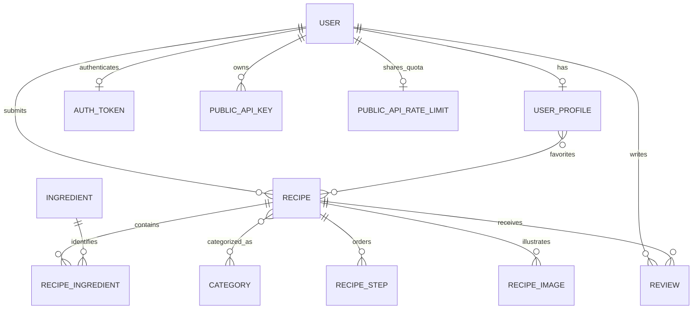

*This project has been created as part of the 42 curriculum by toferrei, nneves-a, suroh, hladeiro, famendes.*

# Recipe Site

The team names, 42 logins, roles, GitHub accounts and feature contributions below are confirmed. Commit-author aliases and the final chosen-module list with contributor assignments still need confirmation. The module review below does not establish a completed 14-point total.

## Description

Recipe Site is a recipe-sharing application built for ft_transcendence. Visitors browse approved recipes and public profiles. Registered users submit recipes with ingredients, quantities, instructions and photos, edit their profiles, save favorites, and post ratings and written reviews. Their own profile includes saved recipes and a review history. Staff review submissions, explain rejections and decide recipe deletion requests.

The project uses the requirements in [ft_transcendence.pdf](ft_transcendence.pdf), version 21.1. Module requirements and the README requirements are separate from the application's feature checklist.

## Instructions

### Prerequisites

- Linux or WSL, running as your normal user.
- Python 3 and Git on the host.
- Docker Engine and the Docker Compose plugin, already installed, running and accessible to your account without `sudo`.
- A local Docker socket. The launcher does not support a remote Docker endpoint.
- Internet access for the initial container-image and dependency downloads.
- Chrome for the current local browser-trust workflow. WSL also needs Windows interoperability with `certutil.exe` and `wslpath` available.
- A private root `.env` with the project's credentials.

Node, Django and PostgreSQL run inside containers; installing them on the host is unnecessary for the normal launcher.

### Configure a checkout

From the repository root, create `.env` from the example only if you do not already have one:

```sh
cp -n .env.example .env
```

Edit `.env` and supply nonempty `DJANGO_SECRET_KEY` and `POSTGRES_PASSWORD`. For an existing installation, retain its credentials and stored data. Get the correct project configuration from your team when using a shared checkout.

| Setting | Purpose / default |
| --- | --- |
| `DJANGO_SECRET_KEY` | Private Django application secret; required. |
| `POSTGRES_PASSWORD` | Private database password; required. |
| `DJANGO_DEBUG` | Defaults to `False`. |
| `DJANGO_ALLOWED_HOSTS` | Example allows `localhost`, `127.0.0.1` and the internal `backend` hostname. |
| `DJANGO_POSTGRES_DB` | Backend database selection; defaults to `recipes`. |
| `HTTPS_PORT` | Optional external HTTPS port; defaults to `8443`. |
| `FRONTEND_PORT` | Optional HTTP redirect port; defaults to `5173`. |
| `MEAL_PLANNER_PORT` | Optional separate Public API Tester port; defaults to `8765`. |
| `SERVER_NAME` | Optional local certificate/server name; defaults to `localhost`. |
| `TLS_CERT_DIR` | Optional certificate directory; defaults to `./certs`. |

The private `.env`, certificate keys and local CA are machine configuration. `.env.example` documents the required settings without their values.

### Start the application

On Linux, close Chrome before the launcher updates its user certificate store. From the repository root, run:

```sh
sh scripts/start.sh
```

The launcher prepares certificate tools in Docker, creates or checks the local HTTPS certificate, imports the public CA into the supported user/browser trust store, prepares the shared database selection, and builds/starts Recipe Site and the separate Public API Tester service. Django migrations and static-file collection run during backend startup. It then exports the current database and referenced photos to the shared folder.

On WSL, confirm the Windows user certificate-trust prompt if it appears. Fully restart Chrome after trust setup, including private windows.

Open **https://localhost:8443/** for Recipe Site and **http://localhost:8765/** for Public API Tester with the default configuration. HTTP on `http://localhost:5173/` redirects to Recipe Site HTTPS. Compose binds all three published ports to the local loopback interface.

### Use the website

| Page | Purpose |
| --- | --- |
| `/` | Approved recipe rankings, recently added recipes and navigation. |
| `/results/search?q=rice` | Search approved recipe titles and public usernames/names. |
| `/recipe/<id>` | Recipe details, photos, ratings/reviews and authorized recipe actions. |
| `/add-recipe` | Signed-in recipe submission. |
| `/recipe/<id>/edit` | Owner/staff recipe editing. |
| `/profile` | Your own profile, submitted recipes, favorites, review history and private public-API access controls. |
| `/users/<account-id>` | A public profile and its approved recipes. |
| `/staff` | Website recipe management for staff. |
| `/admin/` | Django administration for accounts with the necessary permissions. |
| `/privacy` | Public privacy information about stored data, visibility, moderation and deletion. |
| `/terms` | Public terms for accounts, submissions, reviews and moderation. |

Use **Connect** to sign up or sign in. Login accepts a username or email address with a password. Pending/rejected recipe details are available to their owner and staff.

If you need to create the first local Django administrator, this command creates a superuser interactively:

```sh
docker compose exec backend python manage.py createsuperuser
```

Website staff status and Django model permissions are distinct: access to `/staff` does not by itself grant every Django-admin permission.

### Stop and inspect services

These commands inspect the service state/logs or stop containers while preserving their volumes:

```sh
docker compose ps
docker compose logs --tail=80 backend
docker compose stop
```

### Shared project data

The current transfer folder is `data/shared-database/`, containing `shared-data`, `manifest.json`, referenced photos, and (after a new export) actual recipe records in `recipes.json` and `recipes.csv`. Normal startup loads a changed downloaded copy, retains local-only recipes and linked records, and exports the combined result. Git delivery remains manual.

To export changes made since startup:

```sh
sh scripts/export.sh
```

Export briefly stops the backend for a consistent snapshot, then restarts it. An API request during this pause may receive a temporary gateway error. Wait for export to finish before using the website.

The shared database archive is unencrypted. This transfer mechanism is not live synchronization: matching downloaded recipes take precedence, and conflicting edits, renames and deletions across computers have limitations. Normalized ingredient/category reuse protects website submissions; the importer preserves existing same-name records and their relationships.

## Team Information

The team has five members: Tomaz, Nuno, Roh, Hugo and Fabio. Every member is a developer. Tomaz, Nuno and Roh also hold the coordination roles listed below. Names, 42 logins, roles and GitHub accounts are recorded from the team's supplied information.

| Member | GitHub account | 42 login | Assigned roles | Responsibilities |
| --- | --- | --- | --- | --- |
| Tomaz Lima (Tomaz) | [theetom](https://github.com/theetom) | `toferrei` | Product Owner; Developer | Product direction, backlog priorities and acceptance of completed features; backend development, including serializers. |
| Nuno Andrezo (Nuno) | [NunoAndrezo](https://github.com/NunoAndrezo) | `nneves-a` | Project Manager; Developer | Team communication, meeting scheduling and work coordination; checking the project's Docker setup and connections. |
| Roh | [IDsuroh](https://github.com/IDsuroh) | `suroh` | Technical Lead; Developer | Technical leadership; frontend development, Vite integration, visual-output checks and browser/API verification. |
| Hugo Emanuel Ladeiro Nobre (Hugo) | [Anzohs](https://github.com/Anzohs) | `hladeiro` | Developer | Frontend development, Vite integration and visual-output checks with Roh. |
| Fabio | [FaMe1337](https://github.com/FaMe1337) | `famendes` | Developer | Support for frontend and backend development as needed. |

## Project Management

Product ownership is assigned to Tomaz, project coordination to Nuno and technical leadership to Roh. All five members share development responsibilities. Their confirmed work areas are recorded in the Individual Contributions section.

Nuno coordinated team communication and scheduled meetings. Work was divided between Roh and Hugo on the frontend and Vite integration, Tomaz on the backend and serializers, and Fabio providing support across frontend and backend as needed. Nuno also checked that the project's Docker setup and connections worked properly.

Git stores source changes. [WORK_LOG.md](WORK_LOG.md) records implementation decisions, source reviews, user-reported checks and remaining work. Functional acceptance in the current workflow is performed by the user; a source review is not a substitute for a browser/runtime check.

The team used Discord and WhatsApp for communication and coordination.

## Technical Stack

| Layer | Implementation and reason |
| --- | --- |
| Frontend | React 19, React Router 7 and Vite 8 provide component-based UI, browser routing and a production build. |
| Styling | Tailwind CSS 4 is configured alongside shared CSS tokens/components in `frontend/src/index.css` and `App.css`. |
| Backend | The backend image declares Django `>=6.1,<7.0` and Django REST Framework for authentication, serializers, HTTP endpoints and administration. |
| Database | PostgreSQL 17 provides relational constraints, transactions and row locking for the shared recipe data. Django ORM models/migrations manage the relationships and schema. |
| Media | Pillow validates images. Uploaded files live in a Docker volume shared with Nginx for serving. |
| Deployment | Docker Compose runs PostgreSQL, Django/Gunicorn, the built frontend served by Nginx and the independent Python Public API Tester client. |
| HTTPS | mkcert-based local certificates terminate at Nginx, which proxies API/admin traffic to the private backend. |

The frontend build uses Node 22; the backend image uses Python 3.13. See the Dockerfiles and package files for the actual dependency declarations. Django/DRF are one backend, rather than independently deployed microservices.

## Database Schema



| Model / storage | Key data and relationships |
| --- | --- |
| Django user | Username/email, hashed password, names and staff/permission metadata. |
| `UserProfile` | One user; text bio, optional image path and favorites relation. |
| DRF token | One token per user; sent through the website's `Authorization: Token …` header. |
| `Recipe` | Title (`varchar(100)`), text description, owner, timestamp, moderation/deletion booleans, rejection reason and integer `content_revision`. |
| `Ingredient` / `Category` | IDs and names (`varchar(100)`); names can be reused across recipes. |
| `RecipeIngredient` | Recipe/ingredient foreign keys, quantity and unit strings. Each recipe/ingredient pair is unique; website quantities must be positive numbers. |
| `RecipeStep` | Recipe, integer position and text instruction; positions are unique within a recipe. |
| `RecipeImage` | Recipe foreign key and image-file path. |
| `Review` | Recipe/user foreign keys, integer grade, text comment and timestamp; new website reviews require 1–5 stars and a nonblank comment. |

Uploaded bytes are stored in the media volume; image fields store their paths. Public API keys store a secret digest, account/write scope, account-key designation and expiry/revocation metadata; each account has one shared public API quota record. Those key/quota rows are excluded from shared snapshots. The account-key designation is added by migration `0002`, preserving the initial public API migration. The database also contains Django's session, group/permission, admin-log and migration tables. Source models are in `backend/users/`, `backend/recipes/`, `backend/reviews/` and `backend/public_api/`.

## Features List

The team confirmed the frontend/backend credits below. Roh and Hugo also handled Vite integration and visual-output checks. Fabio supported frontend and backend work as needed. Nuno checked the Docker setup and connections; Roh's Codex-assisted deployment/data-sharing work and browser/API verification are recorded in [WORK_LOG.md](WORK_LOG.md).

| Implemented feature | Contributors | Behavior | Main source |
| --- | --- | --- | --- |
| Signup and login | Roh and Hugo (frontend); Tomaz (backend). | Username/email checks, configured password rules, hashed passwords, token login/logout and clear duplicate-signup errors. | `backend/users/`, `SignupPage.jsx`, `LoginPage.jsx` |
| Own/public profiles | Roh and Hugo (frontend); Tomaz (backend). | Own bio/photo updates; public identity/bio/photo and approved recipes; separate public/self response fields. | `backend/users/`, `ProfilePage.jsx`, `PublicUserProfilePage.jsx` |
| Recipe submission/editing | Roh and Hugo (frontend); Tomaz (backend). | Ingredients with per-recipe quantities/units, steps, categories and validated photos; owner/staff write restrictions and transactional saves. Ingredient names are limited to 100 characters in creation and editing, with field-specific validation messages. | `backend/recipes/`, `AddRecipePage.jsx` |
| Recipe moderation | Roh and Hugo (frontend); Tomaz (backend). | Staff approval/rejection, author-visible rejection reason, resubmission and deletion-request decisions. | `recipes/views.py`, `AdminPage.jsx`, `RecipePage.jsx` |
| Changed-content guard | Roh and Hugo (frontend); Tomaz (backend). | Website edits increment a content revision. Stale owner/staff edits and stale staff approval/rejection return HTTP 409 before overwriting newer recipe contents. | Recipe serializers/views, `moderationApi.js`, `AddRecipePage.jsx` |
| Ratings/reviews | Roh and Hugo (frontend); Tomaz (backend). | Signed-in reviews of approved recipes, reviewer names/dates, 1–5 validation, permission-checked deletion, own review history and consistent averages/counts. | `backend/reviews/`, `backend/users/`, `RecipeReviewForm.jsx`, `ProfilePage.jsx` |
| Favorites | Roh and Hugo (frontend); Tomaz (backend). | Signed-in users add approved recipes to their own favorites and remove saved entries. Their profile lists saved recipes and supports removing unavailable entries. | `backend/users/views.py`, `recipeApi.js`, `RecipePage.jsx`, `ProfilePage.jsx` |
| Shared-view refresh | Roh and Hugo (frontend). | Visible recipe, profile, home, search and staff views refresh on a five-second delay after the previous request completes and when focus returns. Unsaved editor drafts are retained. | `useLiveRefresh.js` and its page callers |
| Discovery | Roh and Hugo (frontend); Tomaz (existing backend); Roh (Codex-assisted Module05 implementation and browser verification). | Approved recipe-title/user-name search, public author links, recent recipes and 30-day rating/review rankings with real photo previews. Recipe search has user-verified category/ingredient/minimum-rating filters, title/rating/review sorting and pagination. | `HomePage.jsx`, `SearchResultsPage.jsx`, `recipeSearch.js`, `RecipePreviewCard.jsx` |
| Public recipe API | Roh (Codex-assisted Module06 integration), reusing Tomaz's recipe validation and write flows and the shared Roh/Hugo account frontend. | Separate versioned API with automatic account keys at first sign-in, private Profile key controls, expiry/revocation/rotation, five database paths and application/proxy rate limits. API actions follow website account permissions. Module06 is complete: the user reports the tester works, and user-run endpoint, API-key rejection and account rate-limit checks passed. | `backend/public_api/`, login/Profile components, `frontend/nginx.conf`, API section below |
| Duplicate prevention | Roh and Hugo (frontend); Tomaz (backend). | Website names reuse existing IDs ignoring case/outer spaces; repeated ingredient/category rows are rejected, including direct API submissions. | Recipe serializers, `AddRecipePage.jsx` |
| Local deployment/data transfer | Nuno (Docker setup/connection checks); Roh (Codex-assisted deployment/data-sharing work). | HTTPS startup, persistent volumes, health checks, shared database/photo import/export and Module07 JSON/CSV recipe exports and website imports (user-confirmed working). | Compose, `frontend/nginx.conf`, `scripts/` |
| Project policies | Roh and Hugo (frontend). | Public Privacy and Terms pages describe current data collection, public visibility, submission rules, moderation and deletion; footer and reciprocal links are defined. | `PrivacyPage.jsx`, `TermsPage.jsx`, `SiteFooter.jsx` |

The agreed recipe-admin feature scope has been accepted by the user. Qualification for a particular subject module still depends on that module's complete requirements and its evaluation demonstration.

## Modules

The combined React + Django frameworks Major, Django ORM Minor, advanced permissions Major, custom design system Minor, advanced recipe search Minor, secured public API Major and recipe data export/import Minor are complete, with contributors recorded below. Three planned modules remain to qualify, and remaining contributor assignments are unfinished. In this subject, a Major module is worth 2 points and a Minor is worth 1. Incomplete modules do not contribute points.

| Module | Points | Current source evidence / remaining qualification |
| --- | --- | --- |
| Frontend + backend frameworks — Major | 2 | Selected and implemented with React for reusable frontend components and Django for backend routing, validation and administration. Contributors: Roh and Hugo (React frontend); Tomaz (Django backend). Vite is the frontend build tool. Count this combined Major once; exclude the separate frontend/backend framework Minors. |
| Django ORM — Minor | 1 | Selected and implemented with Django models, relationships, migrations and querysets to manage PostgreSQL data consistently in Python. Contributor: Tomaz (backend). |
| Advanced permissions — Major | 2 | Selected, implemented and user-verified to control who can manage accounts and recipes. Django administration provides user CRUD (Create, Read, Update, and Delete: fundamental operations used to manage persistent data in software, database, and APIs) and scoped model-permission grants/revocation; backend checks and role-specific frontend controls enforce owner/staff/guest access. Django admin saves create missing website profiles. Contributors: Tomaz (backend); Roh and Hugo (frontend); Roh (Codex-assisted admin/profile integration fix and verification). |
| Custom design system — Minor | 1 | Complete: Savour Studio palette, typography, shared SVG icons and ten reusable components are implemented and documented below. Guided mobile, desktop, keyboard and form-validation checks were user-verified. Contributor: Roh (design direction, Codex-assisted implementation and verification), building on the shared frontend by Roh and Hugo. |
| File upload/management — Minor | 1 | Image validation, profile previews and saved recipe photo removal exist. Complete the requirement check for supported file types, previews, upload progress, deletion and access policy. |
| Advanced search — Minor | 1 | Module05 is complete: frontend category/ingredient/minimum-rating filters, four sorts and 6/12/24-item pagination are implemented, documented and user-verified, including page reset and URL restoration. Contributor: Roh (Codex-assisted implementation and browser verification), building on Roh and Hugo's frontend and Tomaz's existing approved-recipe API. |
| Public API — Major | 2 | Module06 is complete: a separate public API with automatic account-bound keys and private Profile controls, five database paths covering GET/POST/PUT/DELETE, application/proxy rate limiting and usage documentation are implemented. The user reports Public API Tester works; all five path reads returned 200, missing/invalid keys returned 401, and the account quota allowed 60 requests before returning 429 with `Retry-After: 49`. Its 2 points are included. Contributor: Roh (Codex-assisted integration), using Tomaz's existing recipe validation/write flows and the shared Roh/Hugo account frontend. |
| Standard user management — Major | 2 | Profiles/authentication exist; friends, online status and a default avatar remain absent. |
| User interaction — Major | 2 | Profiles/reviews exist; the module also requires chat and friends. |
| Health/status/backups — Minor | 1 | Container health checks and automatic startup exports exist; a status page and complete recovery demonstration remain. |
| Data export/import — Minor | 1 | Module07 is complete: Profile → Recipe data provides own-recipe selection, portable JSON/CSV downloads with photos, file validation/preview and transactional bulk imports as new pending copies. Digest-bound import receipts support result checks and safe same-request retries. Roh reported both import and export working well on October 31, 2026, following the JSON/CSV downloads. The existing snapshot tools also export readable JSON/CSV and validate bulk restores. Its 1 point is included. Contributor: Roh (Codex-assisted integration), reusing Tomaz's recipe models/validation and the shared account frontend. |
| Additional browsers — Minor | 1 | Requires completed feature checks in two additional browsers and documented limitations. No complete evidence is recorded. |
| Accessibility — Major | 2 | Labels/ARIA/native dialogs help, but source review does not establish full WCAG 2.1 AA compliance. |

The completed frameworks Major (**2 points**), Django ORM Minor (**1 point**), advanced permissions Major (**2 points**), custom design system Minor (**1 point**), advanced search Minor (**1 point**), secured public API Major (**2 points**) and recipe data export/import Minor (**1 point**) total **10 of 14 target points**, leaving **4 points**. Other rows describe possibilities and remaining gaps; this table does not claim a completed 14-point total. Custom modules require their own scope, implementation evidence, contributor attribution and justification.

### Custom design system — Module 04 (1 point, complete)

The Savour Studio design system gives recipe discovery, recipe details and forms a consistent appearance while sharing controls and layouts across pages. Its charcoal panels, ivory text, gold actions and sage accents are defined alongside spacing and corner-radius tokens in [index.css](frontend/src/index.css). DM Serif Display is the heading font and Manrope is the body font, with local system fallbacks. [Icon.jsx](frontend/src/components/Icon.jsx) provides a shared local SVG icon set; [savour-system.css](frontend/src/styles/savour-system.css) applies the common controls, fields, panels and responsive navigation.

These ten reusable components have active application consumers in [frontend/src/components/](frontend/src/components/):

| Component | Purpose and current use |
| --- | --- |
| `Button` | Native button variants and forwarded attributes; login, signup and recipe actions. |
| `FieldError` | Consistent labeled validation feedback; signup, profile, recipe and review forms. |
| `Icon` | Named SVG glyphs with shared sizing and strokes; navigation, cards and recipe actions. |
| `AuthPageShell` | Configurable introduction, form content and status; login and signup. |
| `PageHero` | Shared page heading, lead text and content slot; Connect, policy and not-found pages. |
| `SectionTitle` | Section heading with description and action slots; recipe and user search results. |
| `RecipePreviewCard` | Data-driven recipe preview with layout options and photo fallback; home, search and profiles. |
| `RecipeReviewForm` | Controlled rating/review fields, callbacks, validation and submitting state; recipe details. |
| `SiteHeader` | Shared navigation, search, account controls and responsive menu across routed pages. |
| `SiteFooter` | Shared policy links and mobile navigation across routed pages. |

Roh selected the Savour Studio direction, supplied the six visual references and directed the Codex-assisted implementation, building on the existing shared frontend by Roh and Hugo. Source review confirms the component contracts and their consumers. On October 29, 2026, Roh reported passing the guided visual checks at **390 × 844** for the homepage/menu, recipe details, Add Recipe, profile editor, login/signup, search results, staff, Privacy and Terms pages, including content clearance above mobile navigation. Desktop home/recipe/form layouts and the narrowed-window or docked-DevTools header check also passed. Keyboard checks confirmed visible Tab/Shift+Tab focus, Enter/Escape menu operation with focus returned to the toggle, and readable empty-form validation with focus on the first invalid field. Extra ingredient/category/step cards can be removed while the first card in each group stays protected. These user-reported results complete the module's **1-point** qualification; details are saved in [WORK_LOG.md](WORK_LOG.md).

### Advanced recipe search — Module 05 (1 point, complete)

Advanced search helps people narrow the approved recipe collection and browse matching recipes in a useful order. [SearchResultsPage.jsx](frontend/src/pages/SearchResultsPage.jsx) uses [recipeSearch.js](frontend/src/data/recipeSearch.js) to combine the existing case-insensitive recipe-title substring search with an exact category match ignoring case and outer spaces, an ingredient-name substring filter and a minimum average rating from 1 to 5. A minimum-rating filter includes only reviewed recipes with a qualifying average. Category choices come from the approved collection and merge names that differ only by case or outer spaces. People still match the search text by username or name, including `@username`; recipe filters, sorting and pages do not affect those matches.

The recipe sorts are **Title: A–Z**, **Title: Z–A**, **Highest rated** and **Most reviewed**, with stable title/ID tie-breaking. Filtering and sorting happen before pagination into **6, 12 or 24 recipes per page**. The page shows the result range and provides Previous, Next and numbered links. Applying search settings resets to page 1. Applied settings are stored in the URL for reloading, sharing and browser Back/Forward navigation; invalid numeric or sort settings fall back to supported values. Existing live refresh remains active, and the displayed page is clamped when the matching result count shrinks.

This implementation loads the full approved collection through the existing `/api/recipes/all_recipes/` API and performs recipe filtering, sorting and pagination in the browser. No backend or API-response change was needed. Server-side search and pagination would be needed to reduce transfer and browser work for a large catalogue. Creation dates are absent from the summary response, so the controls do not offer a newest-first sort.

Roh requested and directed the Codex-assisted Module05 frontend implementation, building on the shared frontend by Roh and Hugo and the existing approved-recipe API by Tomaz. On October 30, 2026, Roh reported passing the new controls' appearance, combined category/ingredient filtering and clearing, minimum-rating filtering and all four sorts. Using 30 marked sample recipes, Roh also verified Next/Previous, the 6/12/24-item page sizes and ranges, applying a filter from a later page returning to page 1, refresh persistence and browser Back restoring the earlier search/page. These user-run checks, the source review and the purpose/implementation/contributor documentation complete Module05 for **1 point**, bringing the completed subtotal to **7/14**. Roh subsequently confirmed the temporary sample cleanup was done. See [WORK_LOG.md](WORK_LOG.md) for the actual verification and cleanup record.

### Secured public recipe API — Module 06 (2 points, complete)

The public API lets an external client browse approved recipes and submit or manage recipes through the same account permissions and recipe rules used by the website. Its separate base path is **`https://localhost:8443/api/public/v1`** with the default configuration. Each active website account receives its own designated API key at first successful sign-in; normal users manage it from their private Profile instead of an administrator terminal. This API uses that dedicated key rather than the website login token. Roh directed the Codex-assisted account-key, Profile, rate-limit and endpoint integration, reusing Tomaz's existing recipe validation and transactional create/edit/delete flows and the shared Roh/Hugo account frontend. Roh reports the tester works, and all five public path reads plus missing/invalid-key rejection have passed user-run checks. On October 31, 2026, the user also recorded 60 HTTP 200 responses followed by HTTP 429 with `Retry-After: 49`. This completed the agreed Module06 checklist for **2 points**, bringing the completed total at that stage to **9/14**.

#### Load the implementation

With the existing PostgreSQL/backend running, rebuild the backend and frontend services from the repository root:

```sh
docker compose up -d --no-deps --build --wait --wait-timeout 120 backend frontend
```

Backend startup applies the new migrations. The frontend rebuild loads the Nginx rate-limit configuration. The normal `sh scripts/start.sh` workflow also builds the project and applies migrations, but additionally imports/prepares and exports shared records as described above. These are user-run steps, not recorded successful builds or migrations.

#### Get and manage your account key

1. Sign in with your normal website account, then open **Profile → Public API access**. Signup currently redirects to login; creating an account alone does not issue its API key.
2. Save the newly issued key privately when the panel offers it. First successful sign-in issues the key; opening Profile also provisions the first key for an account whose signed-in session predates this feature. No administrator command is required for this flow.
3. Expand **Public API access** to see current status and expiry; opening the section refreshes that metadata. Use **Show key / Hide key** and **Copy key** for a newly issued key. **Generate new key** creates a replacement and invalidates the old key. **Disable key** stops the current key without creating another one and leaves website login usable. A **Refresh key status** recovery button appears when an error requires a status reload. The normal account key allows read/write requests within the account's existing recipe permissions: an ordinary user manages their own recipes, and staff retain the existing staff actions.

The raw API secret is available only when issued or replaced. The database stores its SHA-256 digest, and the frontend keeps the newly issued secret only in temporary memory; it is not saved in local/session storage, router history or public profile responses. Once shown in Profile, leaving that page or doing a full refresh clears the in-memory copy, so save it privately first. Existing metadata can still be shown; if the raw key was lost, use **Generate new key**, which invalidates the previous key. Show/Hide and Copy controls remain visible when key metadata is loaded, but are disabled with an explanation when the full value is unavailable on the page. Hiding the key or collapsing the section keeps the temporary copy available on that page; reopening the section masks the value until Show key is selected again. The former Clear from this page action has been removed to avoid confusing hiding with discarding the copy.

Automatically issued account keys and Profile replacements use a 30-day lifetime. Signing in again, reloading Profile or ensuring a first key does **not** silently replace an expired or revoked key. Use the explicit new-key/replacement action to resume API access. Revoking the API key leaves the website account and its login working. Keys belong to their account and never grant additional website privileges.

Key and quota records are local to this installation, and their data is excluded from shared database snapshots; the account-key marker uses the existing excluded key table. Keep the secret out of source files, screenshots, logs and shared exports. Use HTTPS and send it in **`Authorization: ApiKey <key>`**, never in the URL. The format is `rpk_<32-character UUID hex>.<43-character secret>`. Issue a separate account key on another installation instead of copying credential records through the shared snapshot.

The Profile controls call the private website endpoint **`/api/me/api-key/`**, authenticated only by the existing website `Authorization: Token <website-token>` over HTTPS. Public API keys cannot authenticate to this endpoint, and the caller cannot select another account. This private management path is separate from the five public database paths below.

| Private method | Behavior |
| --- | --- |
| GET | Read only the signed-in account's current key metadata, never its raw secret. |
| POST | Ensure the account's first key exists; repeat calls return metadata without issuing another secret. Expired/revoked history prevents automatic reactivation. |
| PUT | Explicitly replace the account key using `expected_key_id` from current metadata. |
| DELETE | Revoke the account key using the current `expected_key_id`. |

Successful management replies use **200** with `{user_id, key}` and an `api_key` field only when a new secret was issued. A stale replacement/revocation returns **409**, code `api_key_changed`; reload metadata instead of blindly retrying the old action. The frontend follows the same rule after an uncertain write response.

#### Advanced operator key commands

The CLI remains available for an operator to inspect/revoke keys or create separate client keys, including optional read-only keys. **Manually created CLI keys** are read-only by default; `--write` permits writes within the owner's existing recipe permissions. Automatic account keys already have that write scope and require no CLI setup. `--days` defaults to 30 and accepts 1–365 days for CLI creation/rotation. Replace `YOUR_USERNAME` and the key UUID placeholders below with actual values.

```sh
docker compose exec backend python manage.py public_api_key create --username YOUR_USERNAME --name recipe-client
docker compose exec backend python manage.py public_api_key create --username YOUR_USERNAME --name recipe-writer --write --days 30
docker compose exec backend python manage.py public_api_key list --username YOUR_USERNAME
docker compose exec backend python manage.py public_api_key rotate --id KEY_UUID --days 30
docker compose exec backend python manage.py public_api_key revoke --id KEY_UUID
```

`list` displays metadata, not secrets. `rotate` revokes the selected key and issues a replacement with the same owner/write scope, preserving the account-key designation when rotating a designated account key; use the newly shown secret. `revoke` stops further use. Expired/revoked keys and keys belonging to inactive accounts are rejected. Separate manual client keys do not replace the Profile-managed account key.

#### Paths and permissions

All five paths require a valid API key. Collection responses use `count`, `next`, `previous` and `results`, with `?page=1&page_size=20`; page size defaults to 20 and is capped at 100.

| Path below `/api/public/v1` | Methods | Behavior |
| --- | --- | --- |
| `/recipes/` | GET, POST | GET lists approved recipes. POST with a write key submits a recipe owned by the key's account; it starts pending approval. |
| `/recipes/<id>/` | GET, PUT, DELETE | GET permits approved recipes or unpublished recipes belonging to the caller, plus staff access. PUT/DELETE require a write key and recipe-owner/staff permission. |
| `/categories/` | GET | Lists categories referenced by approved recipes. |
| `/ingredients/` | GET | Lists ingredients referenced by approved recipes. |
| `/me/recipes/` | GET | Lists the key owner's recipes in all moderation states; even staff keys receive only their own recipes here. |

PUT requires the current `content_revision`; a stale revision returns **409** with code `recipe_changed`. An ordinary owner's successful edit returns the recipe to pending approval; a staff edit preserves its current moderation state unless resubmitting. Existing photos are retained by default. `retained_image_ids` selects which current photos to keep, and replacement uploads must leave one or two photos in total. An ordinary owner's DELETE returns **202** and requests staff deletion approval. Staff DELETE returns **204** and removes the recipe. API keys do not bypass moderation or ownership.

#### Request examples

These Bash examples use the public `rootCA.pem` from the same local CA selected by the launcher. If you changed `CAROOT`, `XDG_DATA_HOME`, host or port, use that installation's values. Browser trust does not automatically configure curl's trust store. Do not disable TLS verification or use verbose shell tracing for requests containing a secret.

```bash
RECIPE_API_BASE='https://localhost:8443/api/public/v1'
RECIPE_API_CA="${CAROOT:-${XDG_DATA_HOME:-$HOME/.local/share}/mkcert}/rootCA.pem"
read -rs RECIPE_API_KEY
```

After `read`, paste the key and press Enter; the input is hidden and is not written into a shell command. The following GETs exercise all five path types; set `RECIPE_API_ID` to a recipe ID returned by the approved or own-recipe list.

```bash
curl --cacert "$RECIPE_API_CA" -i -H "Authorization: ApiKey $RECIPE_API_KEY" "$RECIPE_API_BASE/recipes/?page=1&page_size=20"
curl --cacert "$RECIPE_API_CA" -i -H "Authorization: ApiKey $RECIPE_API_KEY" "$RECIPE_API_BASE/categories/"
curl --cacert "$RECIPE_API_CA" -i -H "Authorization: ApiKey $RECIPE_API_KEY" "$RECIPE_API_BASE/ingredients/"
curl --cacert "$RECIPE_API_CA" -i -H "Authorization: ApiKey $RECIPE_API_KEY" "$RECIPE_API_BASE/me/recipes/"
RECIPE_API_ID=123
curl --cacert "$RECIPE_API_CA" -i -H "Authorization: ApiKey $RECIPE_API_KEY" "$RECIPE_API_BASE/recipes/$RECIPE_API_ID/"
```

For POST/PUT/DELETE, use your normal account key or a separately write-enabled client key. Use a disposable recipe so these examples do not modify real recipe contents. POST requires **one or two actual photos**, each at most **5 MiB**, validated as JPEG, PNG, GIF or WebP. Nested multipart fields contain JSON arrays; do not add a JSON Content-Type header to the multipart request.

```bash
RECIPE_API_PHOTO='/absolute/path/to/photo.jpg'
curl --cacert "$RECIPE_API_CA" -i -H "Authorization: ApiKey $RECIPE_API_KEY" \
  -F 'title=Module06 API demo' -F 'description=Temporary API demonstration recipe' \
  -F 'ingredients=[{"name":"rice","quantity":"100","unit":"g"}]' \
  -F 'categories=[{"name":"API demo"}]' \
  -F 'steps=[{"step_number":1,"instruction":"Prepare the ingredients."}]' \
  -F "images=@$RECIPE_API_PHOTO" "$RECIPE_API_BASE/recipes/"
```

POST returns **201**. Set the ID and revision from its response (or a fresh detail GET) before editing. Titles/ingredient/category names have a 100-character limit; ingredient quantities must be positive, names must be unique within a recipe and step numbers must be positive and unique. PUT below changes only the title and preserves current photos.

```bash
RECIPE_API_ID=123
RECIPE_API_REVISION=1
curl --cacert "$RECIPE_API_CA" -i -X PUT \
  -H "Authorization: ApiKey $RECIPE_API_KEY" -H 'Content-Type: application/json' \
  --data "{\"content_revision\":$RECIPE_API_REVISION,\"title\":\"Module06 API demo updated\"}" \
  "$RECIPE_API_BASE/recipes/$RECIPE_API_ID/"
curl --cacert "$RECIPE_API_CA" -i -X DELETE \
  -H "Authorization: ApiKey $RECIPE_API_KEY" "$RECIPE_API_BASE/recipes/$RECIPE_API_ID/"
```

An ordinary owner's deletion request still needs a staff decision; use the existing staff workflow or a staff account's write key to remove the disposable recipe afterward. A key's `--write` flag alone does not make its owner staff. Keep the key loaded for the quota check below, then clear the local shell variable after all checks.

#### Rate limits and verification

The application allows **60 requests per 60-second window per account**, shared across that account's API keys and all public API paths. PostgreSQL-backed counters coordinate Gunicorn workers. Exhausting the account quota returns **429** and a `Retry-After` header. Nginx also applies a **10-request/second per-IP** limit with a burst of 100 to this public API path, including requests without valid keys; proxy rejections return 429 with `Retry-After: 1`. Rotating a key does not give the same account a separate quota. The website's existing API routes are outside these new limits.

For the account-quota check, leave that account's public API idle for a full minute first. This Bash loop sends only safe recipe-list GETs and prints status codes, not the key or response records. If all calls fit within one fresh 60-second window, the first 60 should return 200 and the next should return 429; other requests by the same account use the same allowance. Inspect a throttled response with the earlier `curl -i` GET and follow its `Retry-After` before trying again.

```bash
for ((request_number=1; request_number<=61; request_number++)); do
  curl --cacert "$RECIPE_API_CA" -sS -o /dev/null -w '%{http_code}\n' \
    -H "Authorization: ApiKey $RECIPE_API_KEY" "$RECIPE_API_BASE/recipes/"
done
```

Missing/invalid-key rejection has already passed with HTTP 401. Additional optional regression checks include another ordinary account being unable to edit a disposable recipe, stale revisions returning409, replaced/revoked keys returning401, read-only keys being unable to write, and Profile provisioning/display/expiry behavior. These additional checks have not been reported passed and are not separate Module06 completion blockers under the agreed scope. Any optional write checks should use a disposable record and preserve already accepted website behavior. When finished with the shell examples, clear the local secret variable with `unset RECIPE_API_KEY`.

| Status | Meaning |
| --- | --- |
| 200 / 201 | Successful read/update / recipe submission. |
| 202 / 204 | Owner deletion request awaiting staff / staff deletion completed. |
| 400 | Invalid recipe fields, nested data or photo input. |
| 401 | Missing, malformed, expired, revoked or inactive-account API key. |
| 403 | Read-only key write, non-owner action or inaccessible unpublished recipe. |
| 404 / 405 | Missing recipe/page / unsupported method. |
| 409 | Stale recipe revision or deletion/moderation conflict. |
| 429 | Account or proxy quota exceeded; honor `Retry-After`. |

Application errors and the public API proxy rate-limit response use JSON. Other proxy failures, such as an unavailable backend, can have a different response body. The required account rate-limit check passed on October 31, 2026: 60 requests returned HTTP 200 and request 61 returned HTTP 429 with `Retry-After: 49`. Recovery after the delay was not tested and is optional additional coverage. Module06 is complete for 2 points under the agreed checklist.

#### Separate Public API Tester

[Public API Tester](demos/public-api-tester/index.html) is a separate client for creating, reading, updating and deleting one temporary Recipe Site recipe, with actual HTTP methods, paths, statuses and response bodies shown on screen.

Start it with Recipe Site from the repository root:

```sh
sh scripts/start.sh
```

Open **http://localhost:8765**, alongside Recipe Site at **https://localhost:8443** with default settings. Copy an active key privately from **Profile → Public API access** and choose **Connect API**. If no saved key is available, explicitly generate a replacement in Profile; this invalidates the old key. Connection validates the key with a small public recipe-list GET; CRUD evidence is recorded by the tester controls below. The tester opens by default.

For startup compatibility, the Compose service remains named `meal-planner` and retains the `MEAL_PLANNER_PORT`, `MEAL_PLANNER_CA_FILE` and `MEAL_PLANNER_USER` settings. The app and source directory are now Public API Tester; keeping the service identity lets startup replace an existing container on the same port without orphan cleanup. An optional `MEAL_PLANNER_PORT` changes that port. Stop any standalone instance with Ctrl+C before starting Compose.

The Python standard-library connector is published only on the host's loopback interface. Startup mounts only the existing public CA file read-only, using the launcher's host/rootless user mapping so an owner-readable CA also works. Within Compose it connects to `frontend:443` while retaining the configured Recipe Site hostname for HTTPS certificate verification and the HTTP Host header; it does not disable verification or change CORS. Certificate reload handling also recreates Public API Tester to refresh its in-memory trust. Its credential-free local health check waits for the UI/connector without making upstream API requests. Use `sh scripts/start.sh` for startup or recreation so the public-CA path and user mapping are supplied; normal `docker compose stop` stops it with the project. The standalone `python3 demos/public-api-tester/server.py` option remains available when the Compose tester is stopped; it defaults to loopback and supports `--port`, `--ca` and `--api-base` overrides, and is stopped with Ctrl+C.

The entered API key is held only in the connector process's bounded, one-hour sessions; the browser receives an opaque HttpOnly/SameSite cookie. The key is not put in source files, browser storage, URLs or request logs. **Disconnect** forgets the credential; it does not disable the website's key or delete a temporary recipe. Tracking for that recipe remains available in the same local session when reconnecting, including with a staff key for cleanup. Source API 401 responses clear invalid credentials, and 429 responses show the retry delay without automatically flooding requests. Demo writes are restricted to the recipe ID returned by that session's own create action; there is no arbitrary recipe-ID or API-target input.

To demonstrate the HTTP methods visually, connect a **staff account's API key** for the complete deletion flow and use the following sequence. Every button makes a real secured public API request through the local connector; opening the panel or refreshing its status only reads local tracking metadata.

| Control | Actual public API request | Expected evidence |
| --- | --- | --- |
| Choose a photo, then **Create demo recipe** | `POST /api/public/v1/recipes/` | HTTP **201**, new ID and pending recipe. The connector supplies the sample ingredients and steps; the actual photo must be JPEG, PNG, GIF or WebP and at most 5 MiB. |
| **Read demo recipe** | `GET /api/public/v1/recipes/{id}/` | HTTP **200**, the same ID, title and content revision. |
| Edit the title, then **Rename demo recipe** | `PUT /api/public/v1/recipes/{id}/` | HTTP **200**, changed title and incremented revision; existing photo retained. |
| **Delete demo recipe**, then confirm | `DELETE /api/public/v1/recipes/{id}/` | Staff key: HTTP **204**, actual deletion. Ordinary owner's key: HTTP **202**, staff removal still pending. |
| **Read demo recipe** after staff deletion | `GET /api/public/v1/recipes/{id}/` | HTTP **404**, confirming the record is gone. |

The panel displays actual upstream methods, public API paths, statuses and response JSON with account details omitted and key patterns redacted. The browser's Network panel shows local connector routes; the displayed evidence describes the separate connector-to-Recipe Site request. Each method keeps its latest result for the page visit, and a new successful create resets the previous recipe's results. The temporary recipe starts pending; its owner can find it in Recipe Site's own recipes. Normal accounts can demonstrate the first three methods and a deletion request, then disconnect and connect a staff key to remove the same tracked recipe. Existing recipe ownership/staff rules are unchanged.

Clean up the temporary recipe **before restarting the connector or exporting shared data**. Tracking is process memory only and can be lost when its browser cookie expires or the bounded session is evicted; if so, locate the named recipe in Recipe Site and use staff cleanup there. If a write response is uncertain, the panel blocks further writes until a read reconciles the known recipe; if a create returned no usable ID, check Recipe Site rather than creating repeated copies. Deleting the record follows the existing backend policy for retained photo files; the demo does not change that policy.

On October 31, 2026, Roh reported that the converted Public API Tester works well. A subsequent user-run check returned HTTP 200 for all five public API paths (including recipe19 detail), and HTTP 401 for both missing and invalid keys; all seven checks passed. The subsequent quota check returned 60 HTTP 200 responses and one HTTP 429 with `Retry-After: 49`, completing the final required Module06 checklist item. Module06 is complete for **2 points**; its completion brought the subtotal at that stage to **9/14**. Cross-account permissions, key-lifecycle regressions and post-limit recovery remain optional and unverified; individual CRUD statuses have not been separately reported. Do not export temporary demonstration recipes as finished project data.

### Recipe data export/import — Module 07 (1 point, complete)

This module lets signed-in users download recipe records to their computer and import multiple recipes from a file. Normal recipe saving keeps data in the website database. **Download JSON** writes a structured file with fields and ingredient/step lists; **Download CSV** writes spreadsheet rows. Both website formats include real recipe photos and can be imported back through the website. Roh directed the Codex-assisted Profile panel, private transfer endpoints, format validation and import-receipt integration, reusing Tomaz's recipe models/serializers and the shared Roh/Hugo account frontend. Roh reported both website import and export working well on October 31, 2026. This completes Module07 for **1 point**, bringing the completed total to **10/14**.

#### Load the website controls

With the existing project/PostgreSQL running, rebuild the backend and frontend:

```sh
docker compose up -d --no-deps --build --wait --wait-timeout 120 backend frontend
```

Backend startup applies recipe migration `0008_recipe_import_receipt`; the frontend rebuild loads the Profile controls. This migration changes the sharing fingerprint. Rebuild/migrate the existing selected database directly first; an older shared snapshot may fail the normal launcher's fingerprint check before that migration can run. After checking the feature and cleaning up unwanted temporary recipes, run `sh scripts/export.sh` to refresh the shared bundle for the new schema before the next normal shared-data startup or Git delivery. The website workflow is user-confirmed working; detailed build/migration and CLI export output was not supplied.

#### Use Profile → Recipe data

1. Sign in normally and open **Profile → Recipe data**. No public API key is needed.
2. Select one or more of your own recipes and choose **Download JSON** or **Download CSV**. The file goes to the browser's downloads. Select multiple recipes for a bulk export.
3. Under **Import recipes**, choose a JSON or CSV file downloaded from this section, then click **Check file**. This validates the whole batch and its photos without saving recipes, then lists the recipe names or row/field errors.
4. Click **Import N recipes** after reviewing the names. The whole batch becomes new copies owned by your account, pending approval even for staff. Existing recipes, ownership and moderation decisions are not overwritten. Imported copies appear in your own recipes after refresh/live refresh.
5. If a response is lost, use **Check import result** or **Retry same import** with the same file. The saved request ID and digest let the server return the existing result without creating that batch twice. A not-yet-confirmed result may still be running; retain the same request rather than starting another batch.

The website accepts **1–25 recipes** and files up to **20 MiB**, with one or two JPEG/PNG/GIF/WebP photos per recipe (each at most **5 MiB**). Transfer records support up to 100 ingredients, 50 categories and 200 steps, using the existing field lengths, positive quantities, unique names/step numbers and image-byte validation. JSON includes a `recipe-transfer` marker and version. CSV has a fixed versioned header and nested JSON cells for ingredients/categories/steps/photos; its spreadsheet escaping is reversible to preserve leading apostrophes and formula-like text. Photos are embedded in both formats. Use the original downloaded CSV for import, since a spreadsheet editor can truncate large photo cells. The website files contain recipe contents, not account credentials, owner IDs, reviews or moderation instructions.

Private website-token endpoints under `/api/me/recipe-data/` provide own-recipe metadata, export, validation, import and receipt status. Exports lock selected recipe rows while reading their related content. Every import is revalidated, and its receipt, recipes and photo database rows commit in one transaction; failures roll back the whole batch and remove newly saved photos. Only a request ID and file digest are kept for recovery in the browser session, never the uploaded file or any new credential. If browser storage is unavailable, the panel asks the user to keep the page open until the result is confirmed.

Source files: [RecipeDataPanel.jsx](frontend/src/components/RecipeDataPanel.jsx), [recipeTransfer.js](frontend/src/data/recipeTransfer.js), [transfer_views.py](backend/recipes/transfer_views.py), [transfer_formats.py](backend/recipes/transfer_formats.py) and the import-receipt model/migration. Source reviews and Roh's working website download/import confirmation are recorded separately in WORK_LOG.md; no individual HTTP statuses, batch counts or forced failure/recovery outcomes were supplied.

#### Existing project snapshot tools

The CLI workflow remains available for project-wide backups/transfers. Its readable `recipe-records` files refer to shared photo blobs; they are a different format from the self-contained website downloads. Use the Profile controls to import website JSON/CSV files. Use the complete PostgreSQL bundle with the project snapshot importer.

The normal export command now prepares both readable formats during the same backend-write pause used for the database snapshot:

```sh
sh scripts/export.sh
```

It saves these files in `data/shared-database/`:

| File | Actual contents |
| --- | --- |
| `recipes.json` | A versioned document with a `recipes` array containing every recipe's title, description, owner ID/username, date, moderation status, revision, full ingredient quantities/units, categories, ordered steps and image references. |
| `recipes.csv` | One row per recipe with the same fields and a snapshot ID. Ingredients, categories, steps and images are JSON arrays inside CSV cells. |
| `shared-data`, `manifest.json`, `photos/` | The existing PostgreSQL bulk snapshot, validation metadata and referenced recipe/profile photo blobs. These remain the complete import bundle. |

The readable files contain actual records, not just snapshot metadata. Both are generated from one ordered recipe query; the helper streams records with a 16 MiB limit per structured recipe row. Photo references point to the matching `photos/` blobs in the same shared folder. JSON preserves original text. CSV uses UTF-8 and quoted fields for commas/quotes/newlines; formula-like scalar text is prefixed with an apostrophe for spreadsheet use. Account emails, passwords, login tokens and API keys are not included in either readable recipe export. Empty catalogues produce an empty JSON array and a CSV header.

The **CLI importer** uses the complete PostgreSQL snapshot bundle, rather than importing edits to its readable JSON/CSV sidecars:

```sh
python3 scripts/share-postgres.py import data/shared-database
```

This checks snapshot format/version, migration fingerprint, archive size/header, photo index and blob hashes before restoring. New bundles also require both readable exports to match their exact filenames, byte sizes and SHA-256 checksums. Snapshots without the optional `record_exports` metadata remain supported when their schema/migration fingerprint matches the checkout. Damaged new export files are rejected before a database is created or selected.

Bulk restoration runs in a single PostgreSQL transaction into a **separate database**. For new bundles, its recipe count must match the exported count before a completed restore receipt is saved. A fresh successful import prints `Validated bulk recipe import: N recipes.` followed by the restored database name. This command does not change the website's selected database; the existing startup import/merge workflow is used when selection is wanted. Matching downloaded records take precedence and local-only recipes are retained under the existing merge rules.

The exporter prepares files privately and publishes the manifest last. Individual file replacements are atomic, but the complete bundle is not replaced as one atomic operation; checksum checks reject mismatched new sidecars after an interrupted publication. Always transfer/stage the entire shared folder. The CLI extension preserves existing merge/photo/credential-exclusion behavior. The website controls add the import-receipt migration described above.

On October 31, 2026, Roh reported the JSON/CSV downloads and then confirmed that both import and export work well. Together with the implemented file validation, bulk operations and README documentation, this completes the agreed Module07 checklist for **1 point**. The completed total is **10/14**. This records the user's functional acceptance without claiming specific batch sizes, rejection/recovery scenarios or a separate CLI restore result.

## Individual Contributions

Names, 42 logins, project roles and GitHub accounts are confirmed in Team Information. The feature table records the confirmed frontend/backend credits, and individual work is summarised below. Commit-author names or email aliases and selected-module assignments remain to be matched to those identities.

| Member | GitHub account | 42 login | Commit-author aliases | Implemented features/modules and contribution evidence |
| --- | --- | --- | --- | --- |
| Tomaz | [theetom](https://github.com/theetom) | `toferrei` | Pending | Backend APIs and serializers for signup/login, profiles, recipes/moderation and changed-content guards, reviews/favorites, discovery and duplicate prevention. |
| Nuno | [NunoAndrezo](https://github.com/NunoAndrezo) | `nneves-a` | Pending | Coordinated team communications and meeting dates; checked that the project's Docker setup and connections worked properly. |
| Roh | [IDsuroh](https://github.com/IDsuroh) | `suroh` | Pending | Frontend features credited above with Hugo, Vite integration and visual-output testing; Codex-assisted deployment/data-sharing work, Savour Studio design-system implementation, Module05 search filters/sorting/pagination and Module06 public API/automatic account-key/Profile integration and Module07 website/CLI JSON/CSV export/import integration with user-confirmed website import/export. Selected the visual direction and supplied references. Also performed and reported browser/API acceptance checks, including overlapping review/favorite writes, account isolation, stale-change rejection, extra recipe-card removal and Module05 filtering/sorting/pagination/URL restoration. Module06 accepted results include the working tester, all five path reads, missing/invalid-key rejection and the account rate-limit demonstration. Evidence is in [WORK_LOG.md](WORK_LOG.md). |
| Hugo | [Anzohs](https://github.com/Anzohs) | `hladeiro` | Pending | Frontend work with Roh on authentication/profile pages, recipe/moderation screens, reviews/favorites, discovery, refresh and policy pages; Vite integration and visual-output testing. |
| Fabio | [FaMe1337](https://github.com/FaMe1337) | `famendes` | Pending | Supported both backend and frontend development and provided help as needed. |

Verification challenge documented for `suroh`: establish that actions actually overlap and that old versions cannot overwrite newer contents. Two account sessions used one shared future start time with three Gunicorn workers; saved data and account isolation were checked afterward, and stale edits/approvals were rejected with HTTP 409. The original one-worker configuration was restored.

Selected-module assignments, additional implementation challenges and their solutions, and Git contribution evidence still need team confirmation. Shared challenges can be described with their actual contributors; the subject does not prescribe one unique challenge per member.

## Current Limits and Verification

- Category browsing and related-recipe suggestions have unfinished UI paths; they are not counted as completed features here.
- Advanced recipe search is user-verified and implemented in the browser over the full approved collection. Large-catalogue transfer and processing would benefit from server-side search/pagination.
- Module06 is complete for 2 points based on the working tester report and passed five-path/API-key rejection/account-quota checks, bringing the completed total at that stage to 9/14. Optional cross-account, key-lifecycle and post-limit recovery regressions have not been verified; individual CRUD statuses were not separately supplied.
- Friends/chat/presence, OAuth and 2FA are not implemented.
- Photo URLs are served publicly. Pending/rejected recipe page/API access is restricted separately; media serving remains the project's accepted scope.
- Module07 is complete for 1 point after Roh confirmed the Profile import/export workflow works, bringing the completed total to 10/14. Specific forced validation-failure/recovery scenarios and CLI restore outcomes were not reported. Website downloads embed photos; the separate CLI readable files use photo references and remain distinct from portable website files.
- The shared-folder workflow preserves older duplicate-name records and has cross-computer conflict limitations.

The Savour Studio desktop/mobile layout, menu focus, form-validation and mobile-navigation-clearance checks were performed and reported as passed by Roh on October 29, 2026, as detailed in Module 04 above. Source review and user-run verification are recorded separately in [WORK_LOG.md](WORK_LOG.md).

User-run browser/API checks on October 26–27, 2026 confirmed overlapping review and favorite writes from two ordinary accounts, correct settled totals/averages and account isolation, and stale edit/approval rejection without replacing newer contents. The overlapping writes returned successfully in approximately 24–39 ms in this local test. Both accounts' final checks passed, and the temporary three-worker setting was restored to the original one worker. The detailed results are recorded in [WORK_LOG.md](WORK_LOG.md); these completed cases do not need repeating.

Other recorded user acceptance includes normal review updates, shared-view refresh, 100/101-character ingredient-name boundaries and readable errors, and desktop keyboard/search focus. The user also confirmed that the public Terms and Privacy links open readable policy pages without requiring login. Source inspection and runtime acceptance are recorded separately. The remaining final acceptance review covers a clean-checkout launch, HTTPS and stable Chrome/normal-console behavior. Full chosen-module qualification is handled in the separate module-selection phase.

For a demonstration, use the normal launcher, then exercise signup/login, profile changes, recipe create/edit/photo handling, staff decisions, rejection/resubmission, deletion requests, ratings and search. Check visible state after reloading. The work log retains the detailed duplicate-name, signup-conflict and changed-content test procedures.

## Resources

- [Project subject](ft_transcendence.pdf): mandatory requirements, module criteria and required README sections.
- [React documentation](https://react.dev/learn): components, state and UI events.
- [Django documentation](https://docs.djangoproject.com/en/6.1/): ORM, authentication, admin and migrations.
- [Django REST Framework documentation](https://www.django-rest-framework.org/): serializers, requests, authentication and permissions.
- [PostgreSQL 17 documentation](https://www.postgresql.org/docs/17/): relational storage, transactions and database operations.
- [Docker Compose documentation](https://docs.docker.com/compose/): application services, volumes and lifecycle.
- [Vite documentation](https://vite.dev/guide/): frontend build tooling.
- [mkcert project](https://github.com/FiloSottile/mkcert): local certificate and browser-trust tooling.

### AI Use

Roh (`suroh`) used Codex to build and modify code, and ChatGPT to break down, analyse and review project work. The team also used ChatGPT alongside reference documents to understand the project requirements and work out implementation approaches.

The recorded Codex work covered source analysis, implementation proposals and code changes involving deployment/data-sharing scripts, React forms, search/profiles, favorites and own review history, shared-view refresh, recipe moderation and stale-content guards, password and ingredient validation, ratings, duplicate handling, policy copy, keyboard focus, responsive header layout, source reviews and this README. It also helped prepare and explain the user-run verification helpers. The work log records the scope and actual verification of those sessions; the browser/API results above were performed and reported by Roh.

For the Savour Studio redesign, Roh selected and supplied six visual references. Codex implemented the palette, fonts, shared components and icons, responsive shell, homepage and recipe layouts, then corrected extra recipe-card removal from Roh's feedback. Source reviews and Roh's passed user-run mobile, desktop, keyboard and validation checks are recorded separately in the work log.

For Module05, Roh directed Codex-assisted implementation of the frontend recipe filters, sorting, URL settings and pagination using the existing API, plus a separate removable sample-data helper. Source review, Roh's passed user-run browser verification and user-confirmed sample cleanup are recorded separately; no new backend application implementation is attributed to this work.

For Module06, Roh directed Codex-assisted implementation of the isolated public API, automatic account-key lifecycle, private Profile controls, database/proxy rate limits and this usage documentation, reusing Tomaz's existing recipe validation/write flows and the shared account frontend by Roh and Hugo. Source review and Roh's user-run working-tester, five-path, API-key rejection and rate-limit results are recorded separately. These accepted results complete the agreed 2-point checklist; optional security/lifecycle/recovery checks remain unverified. No raw API keys are included in this documentation.

For Module07, Roh directed Codex-assisted implementation of private Profile download/import controls, portable JSON/CSV with photos, existing-rule batch validation and transactional/idempotent import receipts, plus the earlier CLI recipe-record exports/checksum/count integration and this documentation. Existing recipe models/serializers, account frontend and snapshot tools are reused. Source reviews are recorded separately from Roh's October 31, 2026 confirmation that website import and export work well.

Team members must review, test and understand the implementation attributed to them.
